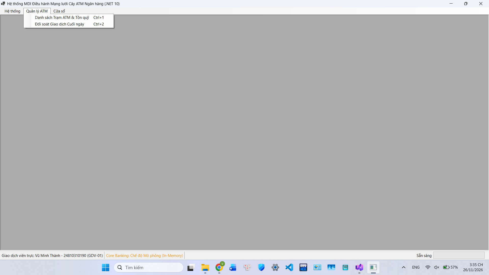
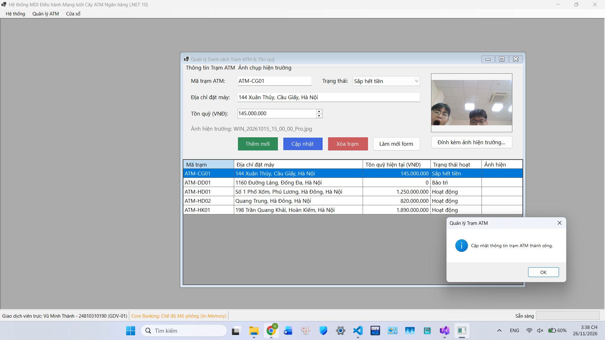
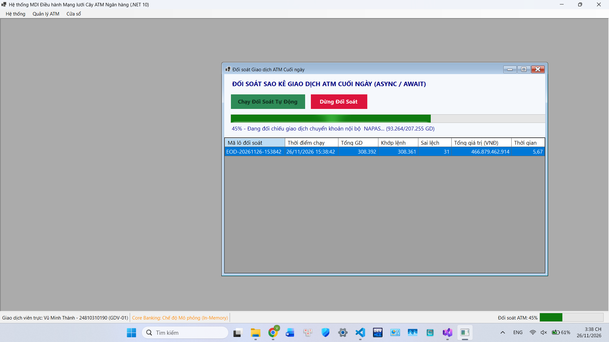
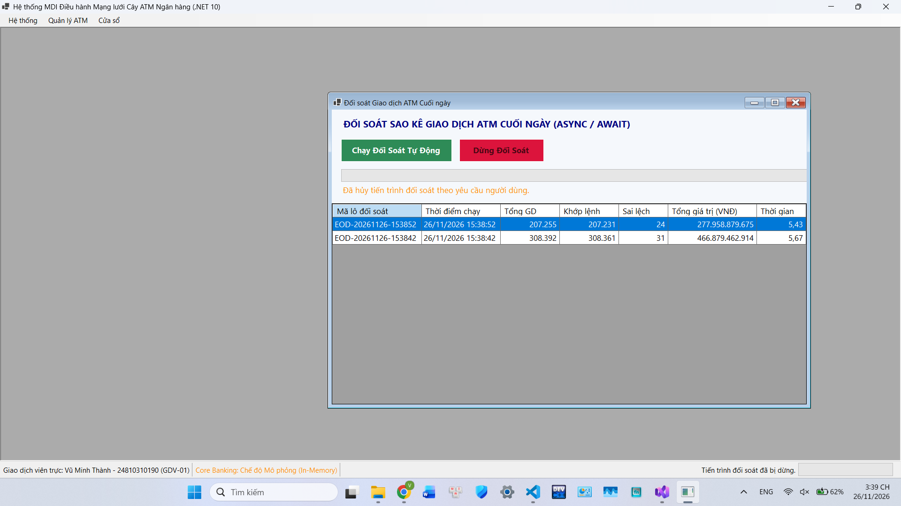
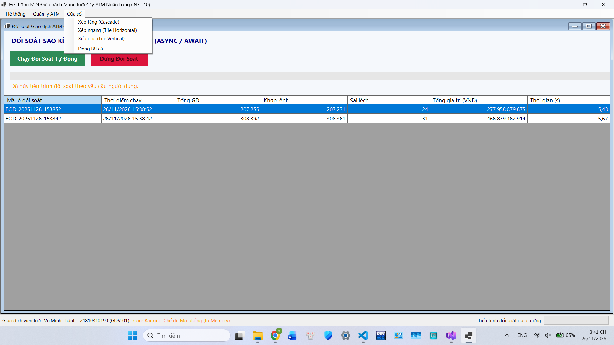

# BÀI TẬP 6.6: HỆ THỐNG MDI ĐIỀU HÀNH MẠNG LƯỚI CÂY ATM NGÂN HÀNG (.NET 10)

Ứng dụng Windows Forms áp dụng kiến trúc **3-Tier (DTO – DAL – BUS – GUI)**, giao diện đa cửa sổ **MDI**, chống mở trùng lặp Form con và xử lý bất đồng bộ với **`async/await` + `Task.Run` + `CancellationTokenSource`**.

## Thông tin sinh viên
- **Họ và tên:** Vũ Minh Thành
- **Mã sinh viên (MSV):** `24810310190`
- **Môn học:** Lập trình .NET (WinForms — Kiến trúc 3-Tier)

## 1. Cấu trúc thư mục
```text
BaiTap_66_ATM_Net10/
├── BaiTap_66_ATM_Net10.sln
├── Database/
│   └── ScriptDB.sql          # Script SQL Server tạo CSDL BankAtmDB
├── DTO/                      # Các lớp đối tượng truyền dữ liệu (net10.0)
├── DAL/                      # Truy xuất SQL Server + Fallback In-Memory (net10.0)
├── BUS/                      # Xử lý nghiệp vụ & đối soát bất đồng bộ (net10.0)
├── GUI/                      # WinForms MDI (net10.0-windows)
├── Screenshots/              # Lưu 5 ảnh chụp màn hình chức năng
└── README.md
```

## 2. Hướng dẫn cài đặt & chạy thử
1. Mở file `BaiTap_66_ATM_Net10.sln` bằng Visual Studio (.NET 10 SDK).
2. *(Tùy chọn)* Chạy `Database/ScriptDB.sql` trên SQL Server Management Studio (SSMS) và chỉnh chuỗi kết nối trong `DAL/DbConnectionConfig.cs` nếu tên Server khác `.`. Nếu chưa bật SQL Server, app tự chạy ở chế độ mô phỏng (In-Memory).
3. Đặt project **`GUI`** làm **Startup Project** và nhấn **F5**.
4. Mật khẩu mặc định mở khóa màn hình (*Hệ thống → Khóa màn hình*): `123456`.

## 3. Ảnh chụp màn hình chức năng (5 ảnh)

### Ảnh 1: Giao diện Form Cha MDI (`frmBankAtmMain`) & MenuStrip / StatusStrip


### Ảnh 2: Quản lý Danh sách Trạm ATM & Đính kèm ảnh hiện trường (`OpenFileDialog`)


### Ảnh 3: Đối soát Giao dịch bất đồng bộ đang chạy (`ToolStripProgressBar` + không treo UI)


### Ảnh 4: Hoàn tất Đối soát & Dừng Đối soát (`CancellationTokenSource`)


### Ảnh 5: Sắp xếp nhiều Form con MDI (`Tile Vertical` / `Cascade`) & chống mở trùng lặp

